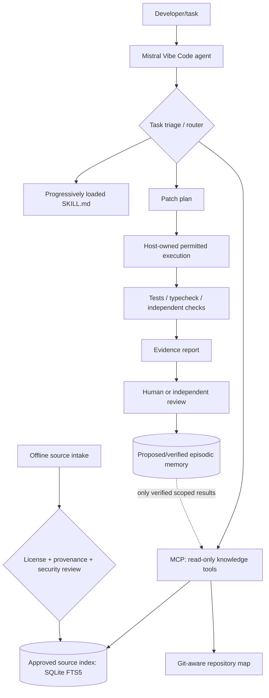

# Architecture and trust boundaries

**Status:** design, not yet running software.

## Runtime data flow



## Component boundaries

| Component | Owns | Must not own |
| --- | --- | --- |
| Vibe host | Model interaction, tool approvals, sessions, shell/file permissions | Hidden auto-permission granted by skill text |
| Plugin package | Discovery metadata, skills, knowledge reference material, MCP registration | Global secrets and project-independent writable data |
| Knowledge MCP | Narrow read-only `brain_search` / `brain_get` interface | Shell access, unrestricted URL fetch, automatic new source approval |
| Ingestion service | Parse, chunk, canonicalize, hash, license/provenance gate | Running embedded instructions from retrieved content |
| Repository index | Git SHA, symbols, references, language parser versions | Treating stale branch maps as current |
| Memory curator | Candidate lessons, evidence, review metadata, invalidation | Autonomous self-certification |
| Evaluation harness | Frozen test cases, isolated execution, metrics | Letting benchmark answer keys leak into retrieval |

## Interface contracts (proposed, not native Vibe schemas)

### `brain_search`

Input:
```json
{
  "query": "python asyncio cancellation shutdown",
  "limit": 5,
  "scope": {
    "source_types": ["official_docs", "verified_memory"],
    "repository_commit": null
  }
}
```

Output:
```json
{
  "results": [
    {
      "chunk_id": 12,
      "source_id": "python-asyncio-docs",
      "locator": "#task-cancellation",
      "uri": "https://docs.python.org/3/library/asyncio-task.html",
      "excerpt": "…",
      "rank": -1.51,
      "version": "3.13",
      "provenance_status": "approved"
    }
  ]
}
```
The result is a **schema example only**; source, chunk ID and ranking are fictitious.

### `brain_get`

Accepts a bounded source/chunk reference; returns full content **with source URL, hash, license and timestamp**. Rejects unknown/revoked sources and excessive responses.

### `memory_propose`

Creates a *proposed* record with task, commit, test evidence and candidate lesson. No agent-facing tool may directly change a proposed record to verified without a separate authorization process.

## Context policy

1. Start with code and repository facts directly related to the task.
2. Prefer exact versioned documentation over loose community discussions.
3. Deduplicate by source fingerprint and conceptual overlap.
4. Bound retrieval by result count and token budget.
5. Keep source trust labels and source paths visible to the agent.
6. Explicitly mark conflicts, insufficient evidence and stale versions.
7. Never accept behavioral instructions carried inside retrieved text.

## Project layout recommendation

- `.vibe/plugins/cognitive-stack/`: **loadable** Vibe plugin package (manifest, skill and knowledge files).
- `docs/`: source-traceable specifications and decisions.
- `src/`: future reusable Python implementation.
- `tests/`: integration, retrieval and adversarial tests.
- `resources/`: reviewed source catalog; raw licensed documents are out of Git.
- `experiments/`: benchmark task manifests (without answer leaks) and runner code.
- Runtime database and source cache: local plugin-owned data directory, never committed.

## Trust boundaries / attack surface

- **Untrusted:** internet documents, package README files, source repositories not under review, tool responses, old memories, arbitrary user-supplied prompts.
- **Trusted under review:** this repository's reviewed source code and pinned dependencies.
- **Privileged:** host approvals, shell and filesystem access, secret stores.
- Do not allow an MCP search endpoint to fetch arbitrary URLs or spawn commands.
- Repository code can contain prompt injection; it must not override developer instructions.
- Keep ingestion in a separate process/permission context from live retrieval.
- Require user review for external side effects, permission escalations, history rewrites and publishing.

## Vibe-specific boundaries to verify

Vibe plugin manifest: `https://agent-plugins.org/schemas/1.0.0/plugin.schema.json`.
The `ai.mistral.vibe` extension enables knowledge and related Vibe-specific features.
Plugin skills are namespaced, e.g. `/cognitive:implement-verify`.
Plugin MCP server specs require the Agent Plugins 1.0 `mcp.json` schema.
Project plugin loads only in a trusted working directory.

**Do not enable an `mcp.json` entry pointing to a nonexistent binary**: first implement, pin and test the server.

## Architectural decisions still open

- SQLite-only vs embeddings: compare on blinded tasks, include retrieval precision and cost.
- Deterministic rules vs model-driven router: start deterministic to isolate value.
- Native vs plugin skill location: use plugin for portable bundle, project `AGENTS.md` for contributor workflow.
- Windows-first packaging: validate local `uv` availability, process lifetime, stdio behavior and approved paths.
